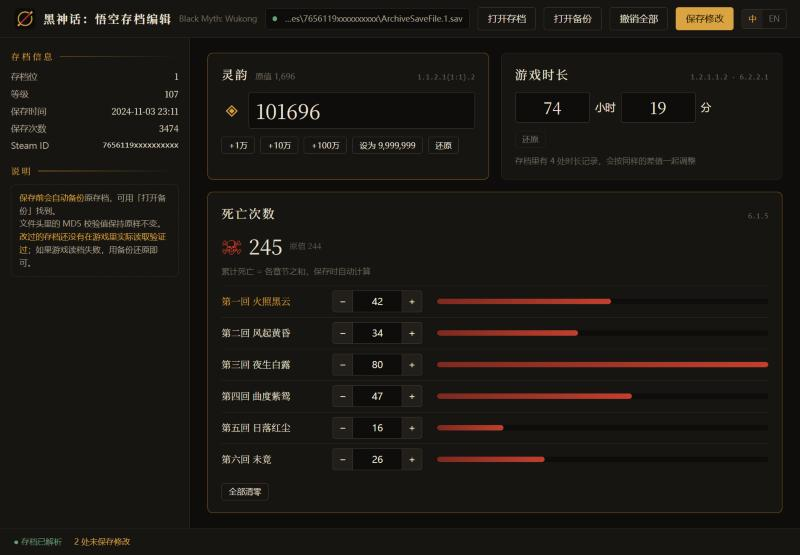
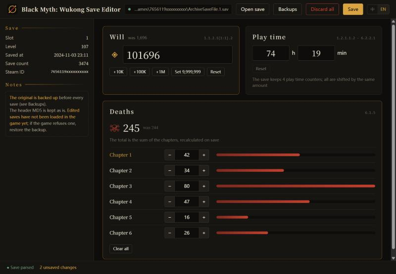

# 黑神话：悟空存档编辑 · Black Myth: Wukong Save Editor

[中文](#中文) · [English](#english)



---

## 中文

《黑神话：悟空》存档统计数据编辑器，界面支持中文和英文。

### 能改什么

- **灵韵**：直接输入，或用 +1万 / +10万 / +100万 快捷按钮。
- **死亡次数**：按章节（第一回～第六回）分别修改；累计死亡次数等于各章之和，保存时自动重算。
- **游戏时长**：按小时 / 分钟修改。

左侧还会显示等级、保存时间、保存次数（只读）。

### 使用

直接运行 `out\BMKONG.exe`（单文件，自带 Python 运行环境）。

从源码运行：

```
cd src
pip install -r requirements.txt
python run.py
```

存档位置：`<游戏目录>\b1\Saved\SaveGames\<Steam ID>\ArchiveSaveFile.N.sav`，N 是存档位编号。程序会自动在 Steam 库里查找。

每次保存前会自动把原存档备份到 `%LOCALAPPDATA%\BMKong\backups`，想恢复时把备份复制回存档目录、改回原文件名即可。游戏运行时无法保存。

`python run.py --serve` 会改为在浏览器中打开（http://127.0.0.1:8766），便于调试界面。

### 校验值

游戏读档时会校验文件头里的 MD5，对不上就提示校验错误、拒绝读取。编辑器每次保存都会重新计算它。

如果存档的校验值已经不对（比如被早期版本的本编辑器改过），左侧会出现「校验值不匹配」提示，点「修复校验值」即可：只重写校验值，存档内容不变。

### 存档格式

加密方式、校验算法和各数据的字段位置见 [doc/save-format.md](doc/save-format.md)。

### 打包 exe

```
pip install -r src\requirements.txt pyinstaller pillow
src\tools\build_exe.bat
```

生成 `out\BMKONG.exe`。图标由 `src/tools/make_icon.py` 生成到 `src/assets/`。

### 测试

```
cd src
set BMKONG_TEST_SAVE=<存档副本路径>
python -m unittest tests.test_roundtrip -v
```

测试只在临时副本上读写，不会改动原存档。

---

## English

A statistics editor for Black Myth: Wukong saves. The UI is in Chinese and English.



### What it edits

- **Will** (灵韵): type a value or use the +10K / +100K / +1M buttons.
- **Deaths** per chapter (1–6). The total is the sum of the chapters and is recalculated on save.
- **Play time** in hours and minutes.

Level, save time and save count are shown read-only.

### Usage

Run `out\BMKONG.exe` (a single file with its own Python runtime), or from source:

```
cd src
pip install -r requirements.txt
python run.py
```

Saves live in `<game>\b1\Saved\SaveGames\<Steam ID>\ArchiveSaveFile.N.sav` (N = slot) and are found in your Steam libraries automatically.
The original is backed up to `%LOCALAPPDATA%\BMKong\backups` before every save. Saving is refused while the game runs.

### Checksum

The game verifies an MD5 in the file header on load and refuses a save that doesn't match. The editor recomputes it on every save.
A save whose checksum is already wrong (e.g. written by an early version of this editor) shows a "Checksum mismatch" notice with a
"Repair checksum" button that rewrites only the checksum.

### Format

The save format (encryption, checksum, field locations) is documented in Chinese in [doc/save-format.md](doc/save-format.md).
